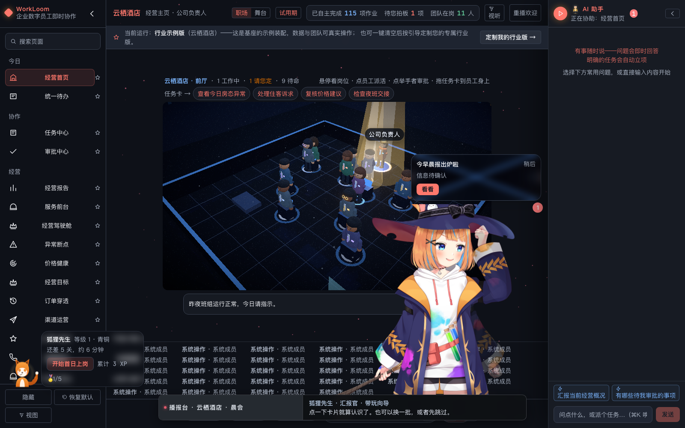
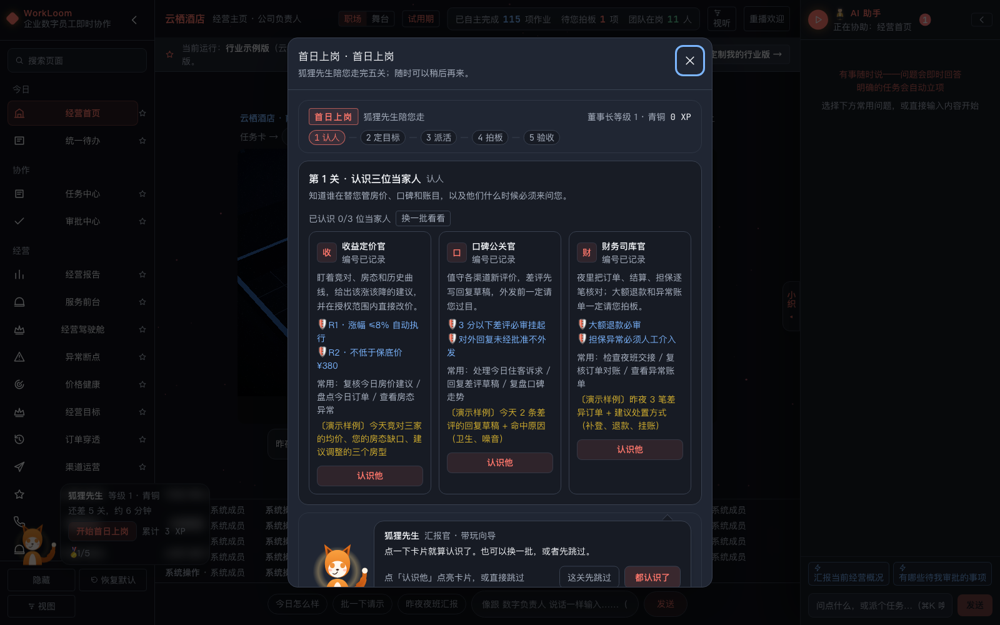

# 懂汇报的狐狸先生 · Workroom Fox

**Fox 用酒店演示场景试验数字员工怎样向人汇报。** 店主能在 3D 职场看到谁在忙、谁需要决定，也能在汇报舞台听晨报和告警。任务、审批和回执仍沿用 WorkLoom 的经营流程。

[首日引导设计](docs/fox-questline.md) · [视听实现](docs/tech-design-m1.md) · [仓库 Agent 指引](AGENTS.md)

## 体验三件事

| 体验 | 操作 |
| --- | --- |
| 在 3D 职场派活 | 看岗位和进度，把任务卡派给合适的数字员工。 |
| 在汇报舞台收消息 | 通过语音和字幕看晨报、待决事项及告警。 |
| 跟狐狸先生上岗 | 依次认识岗位、定目标、派任务、作决定并验收。 |

## 界面预览

下图沿用仓库现有的云栖酒店模拟运行截图。

| 3D 数字职场 | 首日上岗 |
| --- | --- |
|  |  |

## 架构与体验入口

酒店行业包定义业务岗位和规则，WorkLoom 基座提供任务、审批和事件。Fox 在客户端增加 3D 职场、汇报舞台、环境声音、语音和字幕。[架构图](docs/images/architecture.png) · [业务循环图](docs/images/business-loop.png)

在独立环境准备 Node.js 24、仓库声明的 pnpm 和 Docker，运行 `pnpm setup` 后用 `pnpm app` 打开桌面演示，或用 `pnpm preview:all` 查看三端。 [预览清单](PREVIEW_CHECKLIST.md) · [演示数据](mock/README.md)

[酒店上游说明](README-upstream.md) · [数字员工命名规范](docs/agent-naming-spec.md)

## 桌面 Agent 接入（Codex / DeepSeek Harness）

本仓内置桌面 Agent 入口：`node scripts/workloom-agent.mjs list`（能力清单）与
`node scripts/workloom-agent-mcp.mjs`（stdio MCP）。接入步骤、本仓可用能力与安全边界见
[`docs/AGENT-CLIENTS.md`](docs/AGENT-CLIENTS.md)。

<!-- WORKLOOM-AUTONOMOUS-OPERATIONS:BEGIN -->
## 🧭 理论纲领 · AI 自主经营模式

> **客户购买的不是工具，而是一家正在运行的公司。**
> 本仓是 WorkLoom「AI 自主经营」体系的一部分；完整纲领《AI 自主经营纲领——论一个新经营范式的诞生》见 **[AI-AUTONOMOUS-OPERATIONS.md](AI-AUTONOMOUS-OPERATIONS.md)**。

- **成本结构翻转**：人类公司的管理动作，是为"人不可靠"支付的三种对冲税（激励 / 层级 / 监督）；AI 自治退掉这笔税，转而为 **边界定义 + 持续评测** 付费。
- **三个翻转**：管理对象从动机 → **边界**；经营动作从传递信息 → **分配注意力**；行业 knowhow 从"人在经验在" → **可计量资产**。
- **责任不可自动化**：AI 不能坐牢、不能赔钱。围栏 / 人审 / 汇报 / 事件账本构成的治理层，是自治的**对价**，不是限制器。
- **终态判据**：没有客户操作，这件事还会不会发生？"开箱即用"不够——终态是 **没开箱就在运营**：首次登录看到的是已经跑出来的业务进展与第一份汇报。
- **自治权是挣来的**：观察 → 请示后执行 → 汇报后执行 → 全权自治，按决策域用回测证据升降档；汇报透明是自治的价格标签。
- **度量即货币**：自治率、客户干预率、回测命中率三条曲线决定自治权扩张；模拟成功不计入自治率。
<!-- WORKLOOM-AUTONOMOUS-OPERATIONS:END -->

<!-- CAPABILITIES:BEGIN -->
<!-- 本区块由 scripts/generate-capabilities.mjs 自动生成（2026-10-02），请勿手改；重跑 pnpm capabilities 更新 -->

## 🧩 系统能力速览（自动生成 · 与代码同步）

> 以下为源码目录与入口清单；实际调用及结果状态见能力导览的独立证据字段，未验证项不能作交付承诺。

- 🖥 **三端应用入口**：PC 端 · B 端工作台 · 移动端 · B 端高保真 · 移动端 · C 端 AI 服务前台
- 🏨 **行业 Bundle（垂直能力包）**：bundles/hotel/
- 🧑‍💼 **数字员工与数字人（本仓自带）**：数字员工中心（`/agents`） · 织伴数字人（Live2D 常驻浮层） · 语音与口型引擎 · Live2D 渲染后端与资产
- 🖐 **操作电脑能力（本仓自带 · 可装生产工作站）**：computer-use 三层感知入口 · HTTP 远程驱动 + MCP server
- 🤖 **AI 自动化引擎（系统内置能力）**：围栏 DSL 引擎 · 技能保鲜环（下行分发） · L2 编排（ASK/QUEST） · 夜班自动运行 · 模型路由 · 五元事件 + RLS 隔离 等 10 项
- ✅ **验证与质量（工程纪律）**：一键安装（bootstrap） · 主测试套件 · 发布门禁 · 五元事件验链 · Agent 能力巡游 · 环境自检
- 🎁 **演示与交付资产**：高保真演示页 ×6 · 官网静态站 · 自带技能 ×5 · 能力导览 PPT · Mock 数据体系

> 📖 完整能力导览（含截图与体验路径）：[docs/capabilities.auto.md](docs/capabilities.auto.md) ｜ 🤖 AI Agent 入口：[AGENTS.md](AGENTS.md) ｜ 🎯 首启必跑：`pnpm preview:all`
<!-- CAPABILITIES:END -->

## 许可

[Apache-2.0](LICENSE) · [原版 README](https://github.com/geniusdapeng-collab/workroom-fox/blob/e22d80fea9a7120e740b0984cf1f1ed30a218f9d/README.md)
